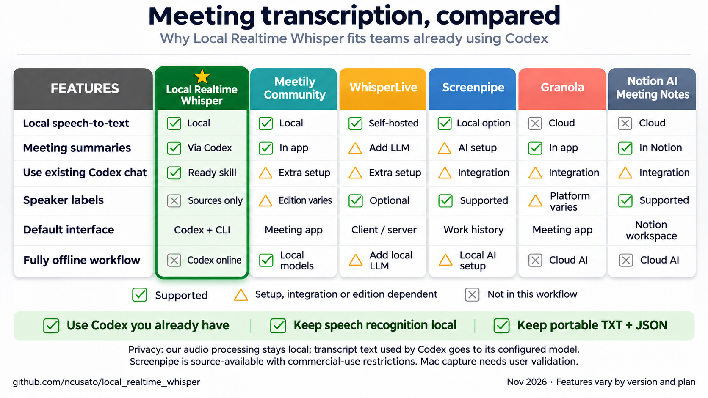

# Local Realtime Whisper

Local microphone and system-audio transcription for **Windows and macOS**, with timestamped console output and questions/summaries in **Codex**. CPU-friendly Whisper base is the default. No transcription API, GPU, or separate question-answering model is needed.

## Background

Meeting assistants such as [Granola](https://www.granola.ai/) and [Notion AI Meeting Notes](https://www.notion.com/product/ai-meeting-notes) make it easier to turn conversations into useful notes and follow-ups. I built this project to bring that workflow into tools I already use: my existing meeting application, a local terminal, and Codex.

The workflow is straightforward: capture microphone and computer audio locally, transcribe it with Whisper, then ask Codex questions during the call or request a summary afterward. There is no meeting bot to invite, separate notes workspace to maintain, or additional transcription service to connect. It works from the selected audio devices rather than a meeting-platform integration. Codex access is still required for the conversational workflow.

## Why a local approach can fit business workflows

For teams already using an approved Codex environment, local speech recognition can reduce the number of services handling meeting audio while keeping questions and follow-ups in a familiar workflow:

- **Keep audio processing on the machine.** This recorder does not upload audio to a transcription provider. Once the model is cached, speech recognition can run offline.
- **Control the artifacts.** Recordings and timestamped text/JSON are stored in a directory you choose. They can be reviewed, moved, or deleted using existing company storage and retention practices. Local files still require appropriate endpoint protection and access controls.
- **Use the tools already at hand.** Keep your normal meeting application and ask Codex “What did we agree?”, “What date was mentioned?”, or “What are my actions?” There is no extra transcription subscription or separate LLM API key for this workflow; existing Codex access and usage limits still apply.
- **Inspect and adapt the workflow.** The capture code, recognition settings, and skill instructions are available in this repo, making the data flow easier to review and the behavior easier to change.

**The privacy boundary matters:** audio recognition is local, but transcript text read by Codex is sent to its configured model for answers and summaries. This is not an entirely offline assistant or a guarantee of compliance. Use an organization-approved environment, follow meeting-recording requirements, and handle recordings according to company policy. Local processing is a useful option when audio handling and workflow simplicity matter; managed meeting products may be a better fit when centralized administration, collaboration, or retention controls are the priority.

## Related projects



*The star highlights this project's column; it is not a rating. Checks show supported capabilities; triangles indicate setup, integration, or edition dependencies. The comparison includes limitations, including our lack of speaker identification and the online Codex step. Features vary by version and plan; this graphic reflects November 2026.*

The commercial-product entries reference [Granola's local/cloud processing explanation](https://www.granola.ai/blog/local-first-ai-notetaker-vs-cloud) and [Notion's AI Meeting Notes documentation](https://www.notion.com/help/ai-meeting-notes). Open-source and source-available project references are linked below.

This project builds on an existing ecosystem rather than a new transcription technique. Depending on the interface and deployment you want, also consider:

| Project | Approach | How this project differs |
| --- | --- | --- |
| [Meetily Community Edition](https://github.com/Zackriya-Solutions/meetily) | MIT-licensed meeting assistant with local transcription and AI summaries. | This repo provides scripts and a Codex skill, using the current Codex chat for questions and summaries. |
| [WhisperLive](https://github.com/collabora/WhisperLive) | MIT-licensed, nearly-live Whisper transcription using a client/server architecture. | This repo focuses on a local microphone/system-audio session with file-based progress and Codex orchestration. |
| [Screenpipe](https://github.com/screenpipe/screenpipe) | Broader screen/audio capture and searchable work history. Its current license is **source-available**, with commercial-use restrictions; it should not be treated as an unrestricted open-source alternative. | This repo captures explicitly started audio sessions and does not record the screen or maintain a continuous work-history service. |

These descriptions refer to the linked projects, not a feature-for-feature evaluation. Review their current licenses and deployment/data-flow settings before business use.

## Use with Codex

Give Codex this repository URL and ask:

> Clone https://github.com/ncusato/local_realtime_whisper.git, read live-transcribe/SKILL.md, and set up local transcription for my OS. Do not start recording until I ask.

Then ask Codex to use the skill file in the checkout:

> Use live-transcribe/SKILL.md to start a session for this call.

During recording, ask “What concepts have come up?”, “What date was mentioned?”, or “What actions were assigned to me?” End with **“Stop transcription and summarize.”** Codex reads the saved text on request and writes the summary; the recorder itself does not call an LLM. To install as a discoverable personal skill, use your Codex skill installer with this repo and the `live-transcribe` subdirectory; run the installed skill's scripts/setup_local.py to prepare its environment. Reading the file explicitly in a cloned checkout is sufficient for the workflow here.

## Setup

Install Git and Python **3.12** (recommended; code requires 3.10+). Clone into a writable directory. All commands below run from the repository root. The environment is created in `live-transcribe/.venv/`. Setup installs dependencies but **does not record audio** or install an audio driver.

### Windows (PowerShell)

```powershell
git clone https://github.com/ncusato/local_realtime_whisper.git
cd local_realtime_whisper
py -3.12 setup_local.py
& .\live-transcribe\.venv\Scripts\python.exe live-transcribe/scripts/live_transcribe.py prepare-model --model base
& .\live-transcribe\.venv\Scripts\python.exe live-transcribe/scripts/live_transcribe.py devices
& .\live-transcribe\.venv\Scripts\python.exe live-transcribe/scripts/start_session.py --session outputs/meeting-001 --source both
```

Windows uses PyAudioWPatch and WASAPI loopback. The default microphone prefers WASAPI, avoiding the legacy host input that overflowed in early testing. Choose `--mic-device INDEX` or `--system-device INDEX` using the device list when necessary. Check Windows microphone privacy permissions for desktop apps. Some systems need the Microsoft Visual C++ runtime required by CTranslate2.

### macOS (Terminal)

```bash
git clone https://github.com/ncusato/local_realtime_whisper.git
cd local_realtime_whisper
python3.12 setup_local.py
live-transcribe/.venv/bin/python live-transcribe/scripts/live_transcribe.py prepare-model --model base
live-transcribe/.venv/bin/python live-transcribe/scripts/live_transcribe.py devices
# Microphone only; no loopback driver required:
live-transcribe/.venv/bin/python live-transcribe/scripts/start_session.py --session outputs/meeting-001 --source mic
```

Allow microphone access for the app running Python (for example Terminal or Codex) when macOS asks; check System Settings → Privacy & Security → Microphone if capture is blocked. The macOS backend uses sounddevice/CoreAudio. If PortAudio cannot be loaded, install it with `brew install portaudio` and retry. Use native Python for your Mac's architecture (Apple Silicon or Intel).

#### macOS system audio / both sources

macOS system audio needs routing to an input device. This implementation uses a separately installed loopback driver, not ScreenCaptureKit.

1. Install [BlackHole 2ch from its official project](https://github.com/ExistentialAudio/BlackHole), or another loopback input you already use. With Homebrew: `brew install blackhole-2ch`. Driver installation may require OS approval/restart.
2. In **Audio MIDI Setup**, create a **Multi-Output Device** containing your listening output (headphones/speakers) and BlackHole 2ch. Follow the project's [Multi-Output Device guide](https://github.com/ExistentialAudio/BlackHole/wiki/Multi-Output-Device) for matching sample rates, clock source, and drift correction. A Multi-Output Device preserves your ability to hear the call while routing a copy to BlackHole.
3. Select that multi-output device for the call application's playback or system sound output. Keep the call app's **microphone set to your physical microphone**; selecting BlackHole as the call microphone can feed remote audio back into the call.
4. Run `devices` again. Pick the physical mic and BlackHole input indices, not the multi-output playback index. Example only—replace **0** and **2** with your own indices:

```bash
live-transcribe/.venv/bin/python live-transcribe/scripts/start_session.py \
  --session outputs/meeting-002 --source both --mic-device 0 --system-device 2
```

System-only capture uses `--source system --system-device INDEX`. The program deliberately requires an explicit system input on Mac and does not change routing automatically. Stop capture before switching devices; restart with a new session and indices. Restore your normal playback output when finished if desired. BlackHole is not bundled in this repository.

## Watch, ask, and stop

Use the environment's Python (`live-transcribe/.venv/bin/python` on Mac; `live-transcribe/.venv/Scripts/python.exe` on Windows). Substitute the session path:

```text
<python> -u live-transcribe/scripts/watch_transcript.py --session outputs/meeting-001
<python> live-transcribe/scripts/live_transcribe.py status --session outputs/meeting-001
<python> live-transcribe/scripts/live_transcribe.py read --session outputs/meeting-001
<python> live-transcribe/scripts/live_transcribe.py read --session outputs/meeting-001 --search capacity --context 3
<python> live-transcribe/scripts/live_transcribe.py stop --session outputs/meeting-001
```

Closing the viewer **does not stop recording**. The stop command ends capture and processes queued windows. Wait for status `stopped` or `failed`; check errors and pending windows. New sessions must use new paths. `--duration SECONDS` is an optional capture limit; `--language en` sets known English instead of per-window language detection. The launcher forwards recording options. Its startup timeout does not terminate a still-loading recorder—check status before retrying.

Files include live `transcript.jsonl`, final `transcript.txt` / `transcript.json`, `status.json`, adjacent launcher logs, and retained overlapping audio in `audio/`. Codex creates `summary.md` after reading the complete transcript. If you run the CLI without Codex, summarize it yourself or with your chosen tool. No automatic call-end detection, speaker identification, music recognition, or slide reading is provided.

## How it works and privacy

Audio input → bounded callback queues → overlapping WAV windows on disk → local faster-whisper/CTranslate2 → timestamped text/JSON → Codex reads text to answer questions. Windows and Mac share the recognition, storage, viewer, and shutdown code. The audio adapters differ.

The multilingual [Whisper base model converted by Systran](https://huggingface.co/Systran/faster-whisper-base) runs on CPU int8. Each source uses 10-second windows with 2-second overlap; VAD suppresses silence, and word timestamp midpoints assign overlapping words to a single window. This is buffered near-live recognition: latency varies with hardware and workload, and boundaries can still repeat or omit words. Apple Silicon GPU/Metal acceleration is not enabled. `--model tiny`, `small`, and `medium` are also accepted; prepare/cache the chosen model first. `LIVE_TRANSCRIBE_MODELS` overrides the default `live-transcribe/models/` cache. Recording/replay is cache-only unless `--allow-download` is passed.

Audio and recognition stay local. Model preparation downloads weights. Transcript text that Codex reads goes to its configured model, so questions and summaries in Codex are **not fully offline**. The skill does not access an undocumented Codex API or inject text into an idle chat. System capture includes whatever plays through the selected output/routed input. Record only sessions you are authorized to record. Retained WAV windows consume disk space and remain until you remove them; the tool does not delete recordings automatically. `.gitignore` excludes normal recording artifacts and model caches; review staged files before publishing changes.

## Validation and support status

Windows capture and safe shutdown were exercised on the original machine. The macOS adapter has mocked callback/device-selection tests; **real macOS device capture has not been tested by the author in this environment**. CI installs dependencies and runs hardware-free tests on Windows and Apple Silicon/Intel macOS runners. CI passing does not establish audio permissions, routing, or meeting accuracy on a user's computer.

```text
<python> -m unittest discover -s tests -v
<python> live-transcribe/scripts/live_transcribe.py replay --input path/to/test.wav --session outputs/replay-001 --model base
```

Replay uses the same windowing and inference without opening a capture device. A new machine should test a short authorized session, check both sources, and review transcript accuracy before relying on it. If capture fails, inspect status and logs; retained windows can be transcribed separately, but must not be blindly concatenated because they overlap.

## Sources

- [OpenAI Whisper](https://github.com/openai/whisper), [faster-whisper](https://github.com/SYSTRAN/faster-whisper), and [CTranslate2](https://opennmt.net/CTranslate2/installation.html).
- [PyAudioWPatch](https://github.com/s0d3s/PyAudioWPatch) for Windows loopback; [sounddevice raw streams](https://python-sounddevice.readthedocs.io/en/latest/api/raw-streams.html) for macOS input.
- [BlackHole](https://github.com/ExistentialAudio/BlackHole) for optional macOS audio routing.

This is a community workflow, not an official OpenAI meeting recorder. Third-party packages, drivers, and model weights retain their own licenses.
